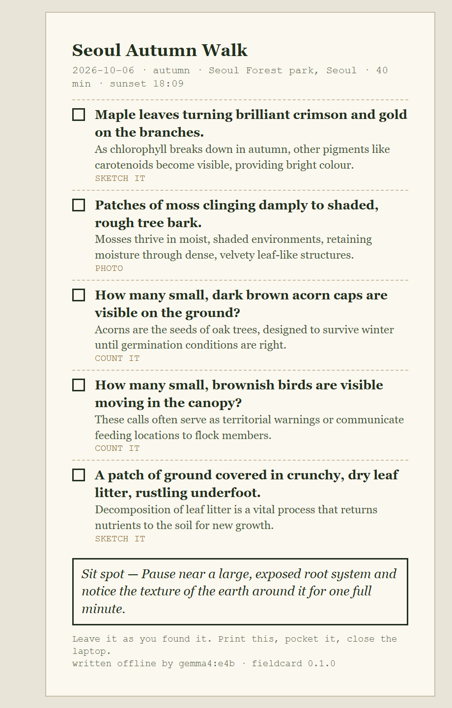
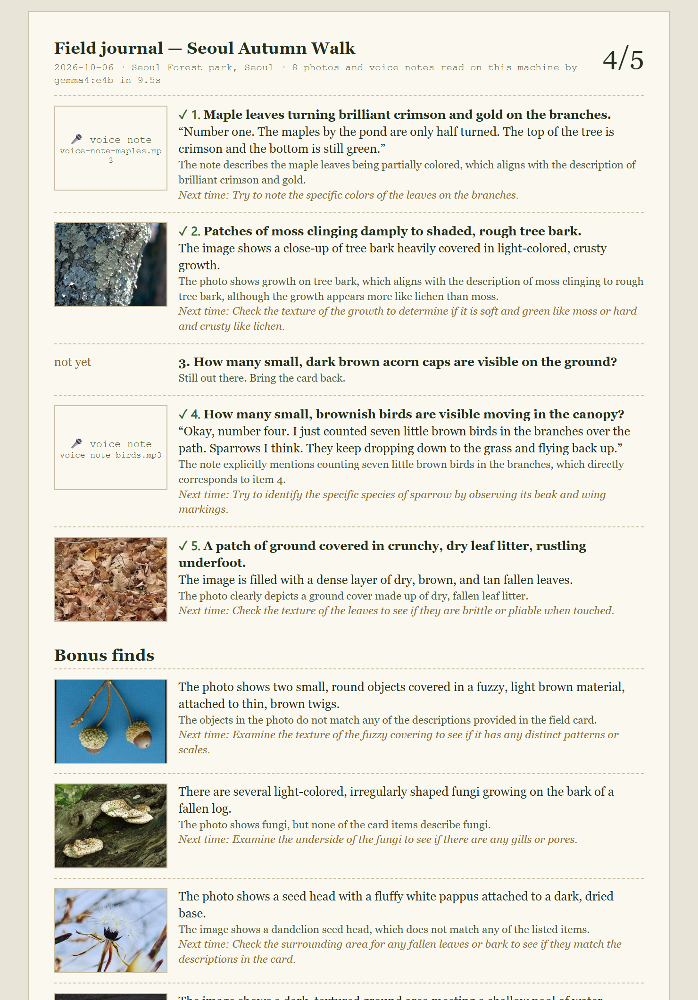

# fieldcard

**A pocket field card, written by an open-weight model on your own computer. The screen is the shortest part of the walk.**

`fieldcard` asks a small local model (Gemma 4 E4B, through [Ollama](https://ollama.com)) for five
things to notice outside today, where you are, in this season, before sunset. It prints them on an
A6 card. You go outside with the card and a pencil. When you come back, the same model looks at your
photos and listens to your voice notes, on the same machine, and writes a one-page field journal.

No account. No API key. No cloud. Run it with `--airplane` and the process refuses every network
connection that isn't to this computer.

| The card (print it) | The journal (after the walk) |
|---|---|
|  |  |

Demo video (87 s, narrated): [docs/fieldcard-demo.mp4](docs/fieldcard-demo.mp4)

Built for the [DEV × Hacktoberfest 2026 Open-Source AI Challenge, Week 1: Touch Grass](https://dev.to/challenges/hacktoberfest-week1-2026-10-05).

## Quick start

You need Python 3.10+ and Ollama.

```bash
ollama pull gemma4:e4b          # about 6.6 GB on disk; text + vision + audio in one open-weight model
git clone https://github.com/kimdooo-a/fieldcard
cd fieldcard

# 1. before the walk (about 3 seconds on a desktop GPU)
python fieldcard.py --airplane quest --place "Seoul Forest park, Seoul" --habitat park \
    --minutes 40 --lat 37.544 --lon 127.037 --tz 9

# 2. print out/<date>-<title>.html, close the laptop, go

# 3. after the walk: drop photos and/or voice notes in a folder
python fieldcard.py --airplane check out/2026-10-06-seoul-autumn-walk.json path/to/walk/
```

Try step 3 right now with the bundled sample walk:

```bash
python fieldcard.py --airplane check examples/2026-10-06-seoul-autumn-walk.json samples/walk
```

Optional: `pip install pillow` (shrinks photos before inference) and `ffmpeg` on PATH (reads
`.m4a`/`.mp3` voice notes; plain `.wav` works without it). Nothing else; the rest is the standard library.

## What it does

**`quest`** builds the context in code, not in the model: season from date and hemisphere, sunrise and
sunset from the NOAA solar formulas (no weather API). Gemma drafts the card as JSON against a schema.
Then plain Python checks every card before it can be printed:

- exactly five items, short enough to read at a glance, no duplicates;
- nothing to eat, taste, forage, touch, feed, climb, catch or go off-trail for;
- no phones, screens or apps on the card;
- if an item says "count it", it has to say what to count.

A card that breaks a rule is sent back with the list of problems and rewritten (two retries by default).
In practice the first draft often fails the counting rule; the rewrite takes about a second.

**`check`** sends each photo (or photo of a pencil sketch) or voice note to the same model with the
card. For photos it describes what is visible and decides which item, if any, the photo is evidence for.
For voice notes it transcribes the note first, so you can keep the phone in your pocket and just say
"number four, seven little brown birds". Each item keeps its most convincing evidence; the rest become
"bonus finds". Every entry gets one "next time" prompt: something to notice with your eyes, ears or nose.

The journal is a static HTML page with the thumbnails inlined. It works offline and prints.

## Options

```
python fieldcard.py [--model gemma4:e4b] [--host http://127.0.0.1:11434] [--airplane] quest
    --place TEXT --habitat {park,forest,city,coast,mountain,garden,riverside,backyard}
    --minutes N --lat F --lon F [--tz HOURS] [--date YYYY-MM-DD] [--note "with a 6-year-old"]
    [--temperature 0.8] [--retries 2] [--out out]

python fieldcard.py [...] check CARD.json FOLDER [--threshold 0.5] [--out DIR]
```

Environment: `FIELDCARD_MODEL`, `FIELDCARD_OLLAMA`. Any Ollama model with vision works for photos;
voice notes need a model with audio input (Gemma 4 E2B/E4B).

## Tests

```bash
python -m unittest discover tests
```

Twelve offline tests (no model needed): season flip by hemisphere, sunset against a published value,
polar night, every card rule, JSON parsing, HTML escaping, and airplane mode refusing the internet while
still allowing localhost.

## Honest limits

- The model is a 7.5B-parameter generalist, not a field guide. It can be generous. In an early run it
  credited a bracket fungus as "moss on bark"; the photo prompt now says that a neighbour is not a
  match. It still accepts lichen for "moss", and says so in the journal.
- Species names on the card are kept general on purpose. Do not use this to decide what is safe to touch
  or eat. The card never asks you to.
- The sample photos are public-domain stand-ins and the sample voice notes are synthetic; see
  [`samples/walk/CREDITS.md`](samples/walk/CREDITS.md).

## Credits

- Model: [Gemma 4](https://ai.google.dev/gemma) (open weights, Google), served by [Ollama](https://github.com/ollama/ollama).
- Sunrise/sunset: NOAA General Solar Position equations.
- Demo narration and sample voice notes: ElevenLabs text-to-speech. Not used at runtime.
- Built with help from an AI coding agent (Claude Code).

## License

MIT, see [LICENSE](LICENSE).
